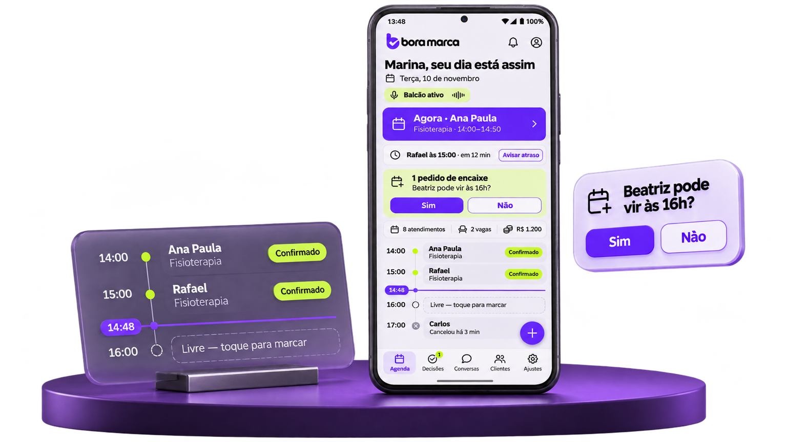

# Uso dos assets no HTML/CSS

Este é um exemplo de aplicação dos arquivos, não o código completo da landing.

## Hero sem distorção

```html
<section class="hero">
  <div class="hero__texto">
    <p>AGENDA INTELIGENTE PARA PROFISSIONAIS</p>
    <h1>Você atende.<br><span>Seu tempo volta.</span></h1>
    <p>WhatsApp, agenda e voz trabalhando com você.</p>
    <a href="#contato">Conhecer a Bora Marca ↗</a>
  </div>
  <picture class="hero__arte">
    <source media="(max-width: 600px)"
      srcset="02-landing/web/01-hero-completo-768.png">
    
  </picture>
</section>
```

```css
@import url('./tokens.css');
* { box-sizing: border-box; }
.hero {
  max-width: var(--bora-container);
  margin-inline: auto;
  padding: var(--bora-gutter);
  display: grid;
  grid-template-columns: minmax(0, .9fr) minmax(0, 1.1fr);
  align-items: center;
  gap: clamp(1.5rem, 3vw, 3rem);
  background: var(--bora-grafite);
  color: var(--bora-neutro);
  border-radius: var(--bora-radius);
  font-family: var(--bora-font);
}
.hero__texto, .hero__arte { min-width: 0; }
.hero h1 { font-size: clamp(2rem, 4vw, 4rem); line-height: 1.04; }
.hero h1 span { color: var(--bora-lima); }
.hero__arte { display: block; }
.hero__arte img { display: block; width: 100%; height: auto; object-fit: contain; }
@media (max-width: 900px) {
  .hero { grid-template-columns: 1fr; }
  .hero__arte { width: min(100%, 44rem); margin-inline: auto; }
}
@media (prefers-reduced-motion: reduce) {
  .hero * { animation: none !important; transition: none !important; }
}
```

O conjunto completo mantém a composição interna do palco. Para aproximar o enquadramento da referência, ajuste a proporção das colunas e o tamanho do conjunto, sem alterar sua razão entre largura e altura.

## Quando usar elementos separados

Use os arquivos 02, 03, 04 e 16 se quiser animar cada objeto ou mudar a posição da placa no mobile. Reserve um contêiner com `position:relative`, atribua larguras percentuais e sempre `height:auto` a cada imagem. Teste em 390, 768, 1024 e 1366 px. Não prenda o palco inteiro a uma altura fixa que force o celular a encolher verticalmente.

As imagens individuais são renderizações independentes. Posicioná-las exatamente como o conjunto completo exige ajustes de enquadramento; use o arquivo 01 quando quiser manter a composição de uma só vez.

## Desempenho e acessibilidade

- Use os SVGs para logo e ícones de interface: são menores e escalam sem perda.
- Use a pasta `web` na aplicação. Guarde os PNGs 4K para masters, telas de alta densidade ou materiais gráficos.
- Informe `width` e `height` reais no HTML para evitar salto de layout. Veja `manifesto.csv`.
- Aplique `loading="lazy"` às imagens abaixo da primeira dobra; não ao hero.
- Deixe títulos, botões, FAQ e informações essenciais em HTML. O texto das interfaces ilustradas não substitui uma explicação acessível da função.
- Fontes da interface podem usar Inter (https://fonts.google.com/specimen/Inter), com fallback do sistema. A logo não depende dessa fonte.
